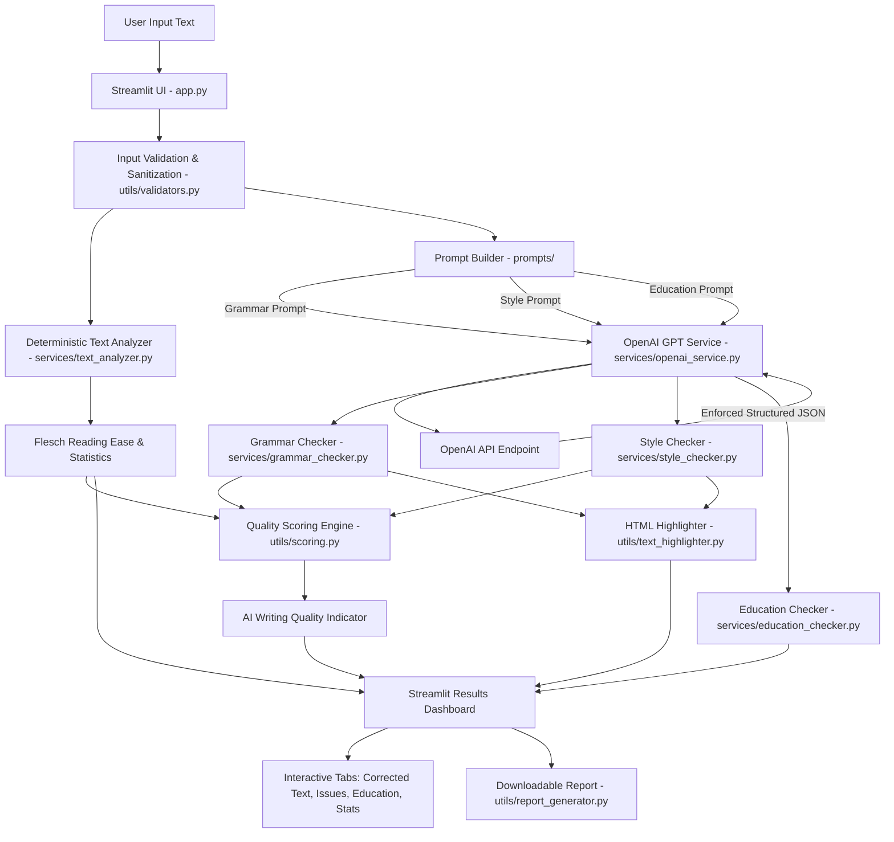

# GrammarlyX — Intelligent Grammar & Style Checker using LLM

> **Explain + Improve + Adapt to Context**  
> An AI-powered writing assistant engineered with Python, Streamlit, and the OpenAI GPT API. Designed for students, researchers, developers, business leaders, and educators.

---

## 1. Project Title
**GrammarlyX: Context-Aware Writing Intelligence & Pedagogical Grammar Assistant**

---

## 2. Project Overview
GrammarlyX is a production-grade, education-focused writing enhancement platform. Unlike basic spell-checkers or black-box rewriting tools that indiscriminately overwrite an author's voice, GrammarlyX operates on the guiding principle of:

$$\text{Explain} + \text{Improve} + \text{Adapt to Context}$$

The system performs deep structural parsing, identifying grammatical faults, mechanical errors, stylistic bottlenecks, tone mismatches, and readability metrics. Most importantly, it adapts its feedback to **seven distinct writing domains** (Education, Academic Research, Business, Technical, Professional, Marketing, and General) and teaches learners the foundational principles behind their mistakes through a dedicated **Education Mode**.

---

## 3. Problem Statement
Traditional rule-based grammar tools suffer from major limitations:
1. **Lack of Context Awareness:** A sentence acceptable in marketing or casual communication (e.g., *"The results are really good"*) is flagged indiscriminately or left unrefined in academic research where scholarly precision is required (*"The results demonstrate statistically significant improvement"*).
2. **Black-Box Rewrites Without Learning:** Modern generative AI chat interfaces often rewrite entire documents without explaining *why* changes were made, preventing students and writers from learning and mastering the rules of language.
3. **Rigid Rule Engines:** Heuristic linters frequently misidentify valid idioms, technical jargon, or variable code identifiers as errors while missing subtle semantic and syntactic agreement flaws.
4. **Disconnect from Empirical Text Statistics:** Many LLM wrappers present hallucinated scores without verifiable, deterministic mathematical foundations.

---

## 4. Objectives
- **Precision Grammar & Mechanics:** Identify and rectify grammar, spelling, punctuation, subject-verb agreement, tense consistency, and structural syntax errors.
- **Contextual Adaptation:** Adapt vocabulary, tone, and sentence architecture according to domain-specific standards.
- **Pedagogical Enrichment:** Provide transparent grammatical rules, error explanations, and memory mnemonics so learners avoid repeating mistakes.
- **Transparent Quality Scoring:** Calculate a deterministic, multi-factor **AI Writing Quality Indicator** based on normalized error densities and Flesch Reading Ease formulas.
- **Production Architecture:** Deliver a modular, secure, CPU-compatible Windows 11 application with robust error recovery and complete data isolation.

---

## 5. Key Features

- **Context-Sensitive Grammar Engine:** Detects errors across 13+ grammatical dimensions with strict JSON schema validation.
- **Dynamic Style & Conciseness Optimizer:** Uncovers wordiness, filler phrases, weak qualifiers, repetitive phrasing, and passive voice imbalances.
- **Education Mode & Pedagogical Breakdown:**
  - *What was wrong?*
  - *Why was it wrong?*
  - *Core grammatical principle/rule*
  - *How to remember it? (Mnemonic / Memory trick)*
  - *Contrastive model example*
- **Deterministic Text Statistics:** Computes word counts, sentence lengths, character counts, paragraph distributions, syllables, and Flesch Reading Ease directly in pure Python.
- **AI Writing Quality Indicator:** A 0–100 quality indicator with documented formula weights (Grammar 50%, Style 30%, Readability 20%).
- **Interactive UI Highlighting:** Highlights grammar issues (in red) and stylistic suggestions (in amber) directly within the original text with hover tooltips.
- **Downloadable Plain-Text Report:** One-click export of an exhaustive analysis summary report (`.txt`) without exposing secret keys.
- **Demo Text Quick-Loader:** Pre-loaded with realistic samples across Education, Academic, Business, and Technical scenarios.

---

## 6. Target Users

| Target User Group | Primary Value & Use Case |
| :--- | :--- |
| **Students** | Learn underlying grammar rules, improve essay structure, and memorize key writing principles. |
| **Teachers & Educators** | Generate objective diagnostic feedback and educational explanations for student submissions. |
| **Academic Researchers** | Polish manuscripts for peer-reviewed journals, eliminating colloquialisms and informal tone. |
| **Developers & Tech Writers** | Ensure documentation, release notes, and READMEs are unambiguous and precise without mangling code syntax. |
| **Business Professionals** | Draft concise executive summaries, formal emails, and client proposals free from corporate filler. |
| **General Users** | Ensure everyday communications, articles, and correspondence are clean, professional, and clear. |

---

## 7. Cross-Industry Applications

- **EdTech & Academic Publishing:** Automated tutoring companion for ESL/EFL students and academic paper pre-submission screening.
- **Enterprise Communications:** Standardizing corporate correspondence and proposal writing.
- **Customer Support & Knowledge Bases:** Ensuring help center articles are clear, accessible, and easily understood.
- **Software Engineering & Open Source:** Auditing documentation, technical specifications, and API guides.

---

## 8. Education Use Case: Learning Mode

Education Mode is the cornerstone differentiator of GrammarlyX. When analyzing text, rather than simply presenting a polished rewrite, GrammarlyX deconstructs each mistake into an individualized lesson.

### Example Pedagogical Flow:
- **Input Text:** `"She don't understand the concept."`
- **Correction:** `"She doesn't understand the concept."`
- **Category:** `Subject-Verb Agreement`
- **Grammatical Rule:** *Third-person singular subjects (he, she, it) require singular verb forms ending in -s in the present tense.*
- **Why Erroneous:** *The subject 'She' is singular, so the auxiliary verb must be 'does not' ('doesn't'), not the plural 'do not' ('don't').*
- **How to Remember:** *Mnemonic: If you can point to 'He, She, or It', make sure the verb has an 'S' (He does, She does, It does).*
- **Contrastive Example:** *Incorrect: "She don't know." | Correct: "She doesn't know."*

---

## 9. System Architecture



---

## 10. Technology Stack

- **Core Language:** Python 3.11+ (Tested on Python 3.13)
- **Frontend / Application Framework:** Streamlit
- **Intelligence Layer:** OpenAI GPT API (`openai` Python SDK v1.12+)
- **Environment Management:** `python-dotenv`
- **Testing Framework:** `pytest`
- **Hardware Profile:** 100% CPU Execution — No GPU, CUDA, or local deep learning weights required.
- **Operating System:** Windows 11 (fully compatible across macOS and Linux).

---

## 11. Project Structure

```
GrammarlyX/
│
├── app.py                      # Main Streamlit web application & UI presentation
├── config.py                   # Central configuration, contexts, tones, and limits
├── requirements.txt            # Minimal, production-ready dependencies
├── README.md                   # Comprehensive academic and technical documentation
├── .env.example                # Template for environment configuration
├── .gitignore                  # Git exclusions for secrets, venvs, and cache
│
├── services/                   # Service layer handling logic and API integration
│   ├── __init__.py
│   ├── openai_service.py       # Robust OpenAI client with JSON enforcement & retry
│   ├── grammar_checker.py      # Grammar, spelling, and mechanics checking
│   ├── style_checker.py        # Clarity, conciseness, and passive voice analysis
│   ├── education_checker.py    # Pedagogical lesson and mnemonic extraction
│   └── text_analyzer.py        # Deterministic text metrics and Flesch readability
│
├── prompts/                    # Context-engineered prompt generators
│   ├── __init__.py
│   ├── grammar_prompt.py       # Grammar detection prompts and schema
│   ├── style_prompt.py         # Context-adapted style prompts and schema
│   └── education_prompt.py     # Educational tutoring prompts and schema
│
├── utils/                      # Modular helper functions and algorithms
│   ├── __init__.py
│   ├── validators.py           # Input sanitization and boundary checks
│   ├── scoring.py              # Mathematical AI Writing Quality scoring
│   ├── text_highlighter.py     # Safe HTML issue highlighting with tooltips
│   └── report_generator.py     # Downloadable .txt analysis report compiler
│
├── tests/                      # Automated unit test suite
│   ├── __init__.py
│   ├── test_text_analyzer.py   # Tests for word counts, syllables, and readability
│   ├── test_validators.py      # Tests for input bounds and sanitization
│   ├── test_scoring.py         # Tests for deterministic scoring and clamping
│   └── test_prompts.py         # Tests for prompt generation and schema integrity
│
└── assets/                     # Screenshots and visual media
    └── README.md
```

---

## 12. Installation (Windows 11)

Open PowerShell or Command Prompt in the project root:

```powershell
# 1. Clone or navigate to the repository
cd C:\Users\23pra\OneDrive\Desktop\GrammarlyX

# 2. Create a clean Python virtual environment
python -m venv venv

# 3. Activate the virtual environment
venv\Scripts\activate

# 4. Install dependencies
pip install -r requirements.txt
```

---

## 13. OpenAI API Setup

> **IMPORTANT REQUIREMENT:**  
> GrammarlyX uses the official OpenAI GPT API for all grammar, style, and educational analysis. An active OpenAI API key and an internet connection are required.

1. Copy `.env.example` to create `.env`:
   ```powershell
   copy .env.example .env
   ```
2. Open `.env` and set your key:
   ```env
   OPENAI_API_KEY=sk-proj-your_actual_openai_api_key_here
   OPENAI_MODEL=gpt-4o-mini
   ```
3. Alternatively, you can enter your API key directly in the sidebar of the running Streamlit web application. Keys entered in the UI are held purely in memory for that session and are never written to disk.

---

## 14. Running the Project

Ensure your virtual environment is active, then launch Streamlit:

```powershell
streamlit run app.py
```

Streamlit will open the application in your default web browser at:
```
http://localhost:8501
```

---

## 15. Screenshots Section Placeholder

| Feature View | Description |
| :--- | :--- |
| **Main Dashboard & Quality Score** | Real-time AI Writing Quality Indicator, Grammar Score, Style Score, and Readability cards. |
| **Interactive Issue Highlighting** | Dual-color in-text highlights with hover tooltips for instant visual feedback. |
| **Education Mode Breakdown** | Deep-dive learning cards containing grammatical rules, fault explanations, and memory mnemonics. |
| **Deterministic Statistics** | Word count, sentence count, paragraph count, syllables, and Flesch-Kincaid metrics. |

*(Place screenshots in the `assets/` folder to embed them in documentation).*

---

## 16. Testing

Run the full automated test suite using `pytest`:

```powershell
pytest -v
```

All included tests execute deterministically in milliseconds without consuming OpenAI API credits:
- Text metrics & syllable estimation
- Sentence splitting across abbreviations (Dr., Prof., e.g.)
- Input validation & safety sanitization
- AI Writing Quality score calculation & penalty clamping
- Prompt construction & schema validation

---

## 17. Limitations
- **External Dependency:** Requires an active OpenAI API subscription and network access for LLM operations.
- **Deterministic Text Stats:** Syllable counting utilizes phonetic heuristics which approximate standard English words accurately, though irregular archaic words may vary slightly.
- **Single Language Scope:** The current release is optimized specifically for English prose.

---

## 18. Future Scope
- **Multilingual Support:** Extending grammatical and educational explanations to Spanish, French, and German.
- **Reference & Citation Audit:** Academic citation format verification (APA, MLA, IEEE, Chicago).
- **Custom Style Guides:** Organization-specific terminology and prohibited phrasing rulebooks.
- **Vocabulary Enrichment Flashcards:** Spaced repetition export for students from identified writing errors.

---

## 19. Security Considerations
- **No Hardcoded Secrets:** API keys are never hardcoded or exposed in frontend views.
- **Source Control Safety:** `.env` and local cache directories are strictly excluded via `.gitignore`.
- **Input Sanitization:** Strips null bytes, non-printable control characters, and mitigates HTML injection before rendering.
- **Session Privacy:** Analysis data resides entirely within the active browser session state.

---

## 20. Author & Academic Attribution
- **Project:** GrammarlyX — Intelligent Grammar & Style Checker using LLM
- **Architecture:** Modular Python / Streamlit / OpenAI GPT
- **Concept:** Explain + Improve + Adapt to Context
